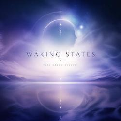

# OpenGameArt: music

**27 assets from [OpenGameArt](https://opengameart.org), dedicated to the public domain under [CC0](https://creativecommons.org/publicdomain/zero/1.0/).** Use them in any game, free or paid, and change them however you like; no credit is needed.

Music from OpenGameArt entries licensed CC0 (some also offer other licences; CC0 is the one that applies here). 660.7 MB in all.

This is a copy kept by [zuujis-cc0](https://github.com/zuujis-cc0) so game makers can take single files from GitHub. It is not made by or affiliated with OpenGameArt: the originals, often in more formats and higher resolutions, are on [opengameart.org](https://opengameart.org). If they help you, consider [supporting OpenGameArt](https://opengameart.org/content/faq).

Every file is listed in [MANIFEST.tsv](MANIFEST.tsv) with its size and SHA-256. More free assets: [the Zuujis collection](https://github.com/zuujis-cc0/free-game-assets#readme).

| | | | |
| :-: | :-: | :-: | :-: |
| <b><a href="trance-battle">Trance Battle</a></b> by MintoDog · <a href="https://opengameart.org/content/trance-battle">source</a> | <b><a href="trance-boss-battle">Trance Boss Battle</a></b> by MintoDog · <a href="https://opengameart.org/content/trance-boss-battle">source</a> | <b><a href="trance-dungeon">Trance Dungeon</a></b> by MintoDog · <a href="https://opengameart.org/content/trance-dungeon">source</a> | <b><a href="tuesday-vibraphone">Tuesday Vibraphone</a></b> by Pro Sensory · <a href="https://opengameart.org/content/tuesday-vibraphone">source</a> |
| <b><a href="undefined-emotion">Undefined Emotion</a></b> by Gena Sealov · <a href="https://opengameart.org/content/undefined-emotion">source</a> | <b><a href="underwater-chiptunes">Underwater chiptunes</a></b> by Guy G. Gamerson · <a href="https://opengameart.org/content/underwater-chiptunes">source</a> | <b><a href="unhappy-man">Unhappy Man</a></b> by kbar1982 · <a href="https://opengameart.org/content/unhappy-man">source</a> | <b><a href="unholy-surge">Unholy Surge</a></b> by vitalezzz · <a href="https://opengameart.org/content/unholy-surge">source</a> |
| <b><a href="unintentional">Unintentional</a></b> by Pro Sensory · <a href="https://opengameart.org/content/unintentional">source</a> | <b><a href="unique-boss-battle">unique boss battle</a></b> by haruta · <a href="https://opengameart.org/content/unique-boss-battle">source</a> | <b><a href="unstable-0">Unstable</a></b> by Tsorthan Grove · <a href="https://opengameart.org/content/unstable-0">source</a> | <b><a href="unsteady-piano">Unsteady Piano</a></b> by Some Weirdo · <a href="https://opengameart.org/content/unsteady-piano">source</a> |
| <b><a href="untitled-main-menu-theme">Untitled Main Menu Theme</a></b> by dabeek · <a href="https://opengameart.org/content/untitled-main-menu-theme">source</a> | <b><a href="upbeat-song">Upbeat song</a></b> by Ruhinre · <a href="https://opengameart.org/content/upbeat-song">source</a> | <b><a href="upper-street-boy">Upper Street Boy</a></b> by iamoneabe · <a href="https://opengameart.org/content/upper-street-boy">source</a> | <b><a href="urban-battle">Urban Battle</a></b> by MintoDog · <a href="https://opengameart.org/content/urban-battle">source</a> |
| <b><a href="urban-boss-battle">Urban Boss Battle</a></b> by MintoDog · <a href="https://opengameart.org/content/urban-boss-battle">source</a> | <b><a href="urban-dungeon">Urban Dungeon</a></b> by MintoDog · <a href="https://opengameart.org/content/urban-dungeon">source</a> | <b><a href="urban-shop">Urban Shop</a></b> by MintoDog · <a href="https://opengameart.org/content/urban-shop">source</a> | <b><a href="urban-theme">Urban Theme</a></b> by MintoDog · <a href="https://opengameart.org/content/urban-theme">source</a> |
| <b><a href="venus">Venus</a></b> by Pro Sensory · <a href="https://opengameart.org/content/venus">source</a> | <b><a href="vintage-hawaii">vintage hawaii</a></b> by Tarush Singhal · <a href="https://opengameart.org/content/vintage-hawaii">source</a> | <b><a href="virtual-rush">Virtual Rush</a></b> by vitalezzz · <a href="https://opengameart.org/content/virtual-rush">source</a> | <b><a href="waiting40">Waiting40</a></b> by Some Weirdo · <a href="https://opengameart.org/content/waiting40">source</a> |
|  <b><a href="waking-states">Waking States</a></b> by Tsorthan Grove · <a href="https://opengameart.org/content/waking-states">source</a> | <b><a href="wanda">wanda</a></b> by haruta · <a href="https://opengameart.org/content/wanda">source</a> | <b><a href="wavy">Wavy</a></b> by Pro Sensory · <a href="https://opengameart.org/content/wavy">source</a> |  |

---

Kept up to date by this repository's own [update workflow](.github/workflows/update.yml), with code and plan from [cc0-mirror](https://github.com/zuujis-cc0/cc0-mirror). Something wrong? [Open an issue there](https://github.com/zuujis-cc0/cc0-mirror/issues/new) or use the [private report form](https://games.zuujis.com/report).
